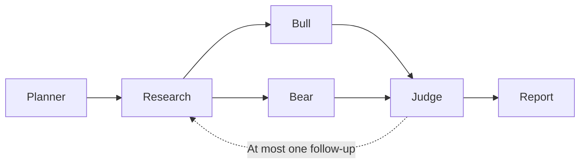

# AgentOps Lab

AgentOps Lab is a portfolio project for evidence-based investment research on AWS. Five LangGraph agents search SEC filings, develop bullish and bearish arguments, and produce a cited report with the Judge’s decisions and open questions.

## Quick start

Install Python 3.12+ and [uv](https://docs.astral.sh/uv/getting-started/installation/).

```sh
uv sync --locked
uv run --locked pytest
```

The tests use stubbed AWS APIs and run offline.

### Run the NVDA analysis

Use `.env.example` to configure `.env` with your AWS Region and SEC index settings. If you use SSO, set `AWS_PROFILE` and sign in first. [AWS setup and ingestion](docs/aws-setup.md)

```sh
BEDROCK_MODEL_ID=eu.amazon.nova-pro-v1:0 uv run --locked --env-file .env \
  agentops-analyze --ticker NVDA > nvda-report.json
```

Agent progress streams to stderr. The JSON report records the filing citations, Judge decisions, unresolved gaps, and model usage.

## How it works



Planner turns research questions into S3 Vectors queries. Research retrieves filing excerpts and preserves their SEC provenance. Bull and Bear run in parallel on the same evidence. Judge checks whether that evidence supports each argument and can request one targeted follow-up.

LangGraph coordinates the workflow, Amazon Bedrock runs Nova Pro and Titan embeddings, and Pydantic validates the report and execution events. Terraform manages the AWS sandbox. The workflow can be called by future AgentCore Runtime and EKS adapters.

## Supervised pilot

The NVIDIA FY2026 Form 10-K yielded **96 indexed excerpts**. A supervised run used **eight excerpts in two research rounds** and completed in **34.7 seconds**. Estimated Bedrock inference cost was **$0.049**. The citation audit found material details the report missed. [Pilot results and limitations](docs/research.md#supervised-investment-run)

## Documentation

- [AWS sandbox setup](docs/aws-setup.md) covers SSO, Bedrock smoke tests, SEC ingestion, and Terraform.
- [Research workflows](docs/research.md) covers the detailed graph, report schema and limits, standalone CLI, and synthetic evaluation.
- [Application source](src/agentops_lab/) contains agent logic, workflow graphs, retrieval, and CLI entry points.
