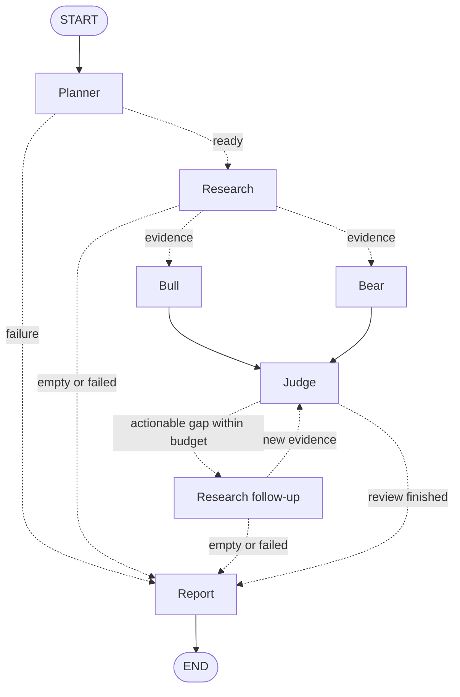

# Research workflows and pilot results

Use this guide for the investment workflow, standalone research commands, and the supervised run results. [Back to the project overview](../README.md) · [AWS sandbox setup](aws-setup.md)

## Investment analysis

Point `.env` at the existing SEC pilot resources and use an AWS identity with the [retrieval permissions](aws-setup.md#nvidia-sec-retrieval-pilot). The investment command defaults to the Nova Pro EU inference profile. An explicit `BEDROCK_MODEL_ID` in the environment or `.env` overrides it, so set it for this invocation if your smoke configuration uses Nova Micro.

```sh
BEDROCK_MODEL_ID=eu.amazon.nova-pro-v1:0 uv run --locked --env-file .env \
  agentops-analyze --ticker NVDA > nvda-report.json
```

The CLI accepts `--question` to focus the analysis on a question about the indexed filing. It writes progress to stderr and a structured report to stdout. A failed graph run returns a report with `status: failed` and exit code 1. A run with no accepted claims returns `status: insufficient_evidence`. Unresolved gaps can also appear in a completed report.

[Report and event schemas](../src/agentops_lab/models/workflow.py)



- **Planner** ranks research questions and supplies the exact queries used to embed and search in S3 Vectors.
- **Research** selects distinct filing excerpts across query ranks, preserves original SEC provenance, and produces findings and material risks. The standalone research command still uses its fixed pilot topics.
- **Bull and Bear** run in parallel on the same evidence and research findings. Bull develops the positive case when the excerpts support it. Bear challenges the assumptions a positive case would need and distinguishes documented risks from conditional scenarios.
- **Judge** receives both branches at the LangGraph join. It checks whether each claim's wording, numbers, time period, and direction follow from the cited evidence. The application separately checks source IDs and verbatim quotes. The Judge can mark a claim `risk_as_upside` when cited downside is presented as upside without affirmative evidence.
- **Follow-up** can run once. A request names the question, its materiality, and the specific evidence needed. Research searches distinct queries and excludes previously selected chunks. The second review assesses affected claims and new findings. Gaps that remain open are explicit in the report.

Defaults allow up to 13 model invocations in total, including Titan embeddings, two research rounds, six retrieval queries, eight distinct excerpts admitted to evidence, three candidate hits per query, and 1,600 output tokens per reasoning call. Use `agentops-analyze --help` to adjust these budgets. The report includes the actual queries, source references, call counts, available token counts, and observed latencies. The Judge is a fallible model reviewer. Quote checks establish that a passage exists. Semantic support and filing coverage still require human review.

`build_investment_graph()` accepts a reasoning callable and a filing store. Its typed state combines parallel agent outputs with reducers for append-only events, call metrics, and errors. Hosting adapters can invoke the graph or read public events through LangGraph's `custom` stream. The structured report and events contain public summaries, source IDs, and review decisions. The core workflow is independent of the future AgentCore Runtime and EKS entry points. [LangGraph streaming](https://docs.langchain.com/oss/python/langgraph/streaming)

### Supervised investment run

On November 23, 2026, the Nova Pro EU profile ran the workflow against the existing Frankfurt SEC index. Planner queries admitted six excerpts across revenue growth, supply, customer concentration, and export controls. Bull and Bear started about 5 ms apart. Judge requested two follow-up queries in one additional round, which admitted two export-control excerpts. The report accepted 10 claims, including 65% annual revenue growth, 68% Data Center growth, and supply and export risks. All three Bear proposals and five other claims failed quote validation. The audited filing included customer concentration and H20 charge details the report missed. The audit led to tests for exact quote fragments with added sentence punctuation and for repeated evidence gaps.

The completed run took 34.7 seconds. Seven Nova Pro calls used 27,589 input and 4,806 output tokens, and six Titan calls used 67 input tokens. Estimated inference cost was $0.0492 at Frankfurt on-demand rates, excluding S3 charges. An earlier attempt stopped after Bear failed schema validation. The completed retry used single-object JSON output, validated by Pydantic. [Frankfurt Bedrock price list](https://pricing.us-east-1.amazonaws.com/offers/v1.0/aws/AmazonBedrock/current/eu-central-1/index.json)

## Local research

From the repository root, run the bundled NVDA demo after [configuring Bedrock](aws-setup.md#bedrock-connectivity).

```sh
uv run --locked --env-file .env agentops-research --ticker NVDA
```

The bundled excerpts are fictional and the output is marked `"synthetic": true`. To supply your own excerpts, use `--input path/to/request.json`. The JSON file contains `company`, `ticker`, and `excerpts`. Each excerpt needs a unique `source_id`, `title`, ISO `document_date`, and `text`. Set `url` when available and `synthetic` on the request when using fictional data. If you pass `--ticker`, it must match the input ticker. The command writes the validated brief as JSON to stdout.

The workflow runs `START → research → END`. The research node receives a typed request, passes the supplied text to the model, and validates a structured analysis. `build_research_brief()` then checks citations and assembles the final report from the request and analysis. Each finding, opportunity, and risk must cite at least one existing source ID. The application copies the cited source metadata from the request and preserves the given company and ticker. If there are no excerpts, the node returns an insufficient-evidence brief without model inference. Citation checks verify that each ID exists in the input. Whether the excerpt supports the wording of a claim still requires review. [LangGraph Graph API](https://docs.langchain.com/oss/python/langgraph/graph-api)

The default output mode uses LangChain's tool-based structured output, which works with Nova Micro through Converse. Nova Micro does not support Bedrock's native JSON-schema output. For models without compatible tool calling, add `--output-mode json` to request a plain JSON object and validate it with Pydantic. Both modes use the configured model, make at most one inference call, and cap the output at 768 tokens. Invalid output fails the command. [Nova Micro capabilities](https://docs.aws.amazon.com/bedrock/latest/userguide/model-card-amazon-nova-micro.html) · [Nova tool choice](https://docs.aws.amazon.com/nova/latest/userguide/tool-choice.html)

## Research quality evaluation

The five cases in `examples/evaluation.synthetic.json` are fictional. Each records expected findings, risks, opportunities, and the source IDs that support them. Some cases also record facts that the agent could incorrectly report as missing, and gaps it should surface.

Run `uv run --locked pytest` for deterministic offline checks. To run the evaluation with Bedrock, use the same AWS configuration as the research CLI. The evaluator makes one model call per selected case and runs all five cases by default.

```sh
uv run --locked --env-file .env agentops-evaluate --case nvda-supplier-risk --case margin-guidance
```

The report shows which expected topics matched, the actual claims and citations, citation ID errors, and gaps or claims to review. Coverage uses case-specific phrase matching. A fact listed as missing is flagged when it matches a topic the fixture marks as disclosed. Numbers absent from cited text, unexpected topics, and unexpected sources also generate review flags. Paraphrases, qualifications, and misleading claims containing the expected words can evade these checks. Read claims against their cited excerpts to judge factual support. The command returns a nonzero exit status for agent failures or citation ID errors. Coverage misses and review flags are diagnostic.

In a three-case comparison using the same synthetic inputs and prompt, Nova Micro covered 4/4 expected findings, 1/3 risks, and 0/3 opportunities. Nova Pro covered 3/4 findings, 3/3 risks, and 2/3 opportunities. Both returned valid citation IDs. These results informed the choice of Nova Pro for supervised SEC research.

## Standalone SEC retrieval

Ingestion extracts narrative from Business, Risk Factors, and MD&A. It strips HTML layout, hidden XBRL, and tables. The source bucket holds complete extracted chunks and their provenance. The index holds embeddings, stable keys, and small filterable metadata fields. Reingesting an identical corpus upserts the same keys. A changed corpus at the same accession is rejected so it cannot mix with previously indexed chunks.

The research command makes four fixed semantic queries filtered to NVDA, covering business growth, supply, customer concentration, and export risks. It checks the section and topic of the nearest hits and interleaves their per-query ranks. It passes at most six distinct chunks to LangGraph. Within one research request, it validates the index once and reads each source JSON object at most once. Lower cosine distance means a closer vector match. `SEC_MAX_DISTANCE` optionally adds a maximum distance, and rank and topical checks apply when it is unset. If retrieval supplies no usable evidence, the graph returns an insufficient-evidence brief. [S3 Vectors query ranking](https://docs.aws.amazon.com/AmazonS3/latest/API/API_S3VectorBuckets_QueryVectors.html)

The brief preserves the filing date, original SEC URL, accession number, section, and chunk number. The agent reports opportunities as inferences and drops any without a matching quote in a cited excerpt. Quote matching makes evidence easier to inspect. Verify that the passage supports the full claim before relying on the brief.

### Observed pilot results

The Frankfurt sandbox indexed **96 chunks** from the filing: 23 Business, 58 Risk Factors, and 15 MD&A. The S3 Vectors index and source corpus contained the same chunk IDs. The Python research command ran locally and called Bedrock for reasoning.

The original three-query smoke test matched two topics at the `0.70` cutoff. The combined supply and customer query ranked an off-topic result ahead of two relevant excerpts just above the cutoff. The revised flow returned topical evidence for all four queries with the cutoff unset. It passed six distinct excerpts to Nova Pro. `agentops-sec-smoke --show-text` displays the sections, distances, and excerpt text so a reviewer can repeat the retrieval check independently.

A subsequent live retrieval check confirmed six distinct excerpts from four vector queries, with one index validation and one S3 source read.

The supervised brief cited four chunks and reported customer concentration, supply constraints, and export controls separately. Review found that a networking-sales opportunity inferred upside from a passage about downside risk. A missing-information entry about the H20 charge also needed to specify the detail that was absent. These gaps matter when later agents consume the brief. Preserve the cited evidence and keep human review in the loop.
